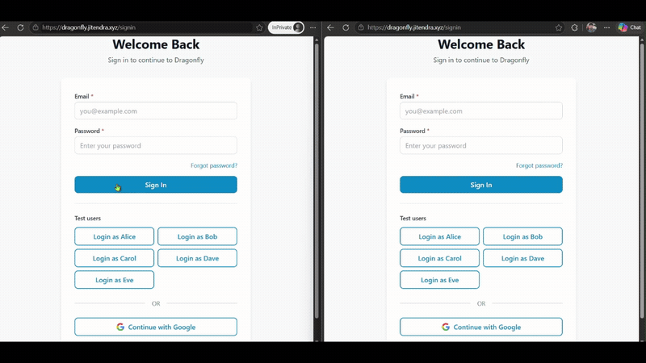
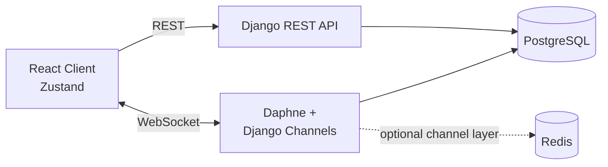
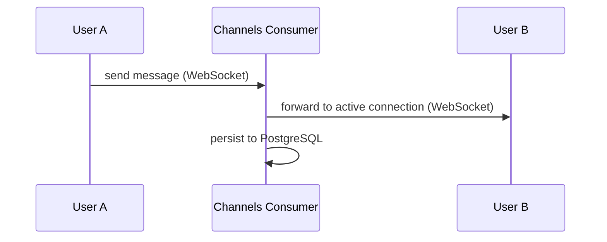

<div align="center">

<picture>
  <!-- <source media="(prefers-color-scheme: dark)" srcset=".github/portfolio-icon-200.png">
  <source media="(prefers-color-scheme: light)" srcset=".github/portfolio-icon-200.png"> -->
  
</picture>

# Dragonfly

**A full-stack real-time messaging platform built with React and Django.**

Dragonfly combines a React/Vite client, Django REST APIs, JWT authentication,
and a Django Channels WebSocket chat path. It is a compact showcase project
for real-time product flows, testing, containerization, and deployment.

[](https://github.com/jitendra-ky/dragonfly/actions/workflows/tests_ci.yml)
[](LICENSE)
[](frontend/package.json)
[](requirements/development.txt)
[](https://codecov.io/gh/jitendra-ky/dragonfly)
[](https://github.com/jitendra-ky/dragonfly/releases)
[](https://github.com/astral-sh/ruff)
[](https://github.com/prettier/prettier)
[](https://github.com/jitendra-ky/dragonfly/graphs/contributors)
[](https://github.com/jitendra-ky/dragonfly/stargazers)
[](https://hub.docker.com/r/jitenky/dragonfly-test)
[](https://github.com/jitendra-ky/)

> **Live demo:** https://dragonfly.jitendraky.xyz

</div>

## Demo



## Core features

### Product features

- Real-time one-to-one messaging over an authenticated WebSocket.
- Message persistence and history through the REST API.
- Contact discovery from message history and a list of all users.
- Email/password sign-in with JWT access and refresh tokens.
- OTP-based sign-up verification and password reset.
- Google OAuth sign-in endpoint.
- Read-state updates from the chat client.

### Infrastructure and quality

- ASGI serving through Daphne and Django Channels.
- Development settings with SQLite; production settings require a PostgreSQL
  `DATABASE_URL`.
- Dockerfiles for tests, production, and the AWS showcase deployment.
- GitHub Actions for backend tests/coverage/Ruff and frontend lint/tests.
- Render configuration in [`render.yaml`](render.yaml).

## Architecture
1. **High-level architecture diagram** shows the components and how they connect: React client, REST API, WebSocket layer (Daphne and Channels), PostgreSQL, and deployment environments.


2. **Message flow sequence diagram** shows the current direct-connection flow when User A sends a message and User B receives it in real time.


The verified request flow is:

1. The React client calls the Django REST API over HTTP/JSON.
2. The client opens `/ws/chat` through the ASGI application served by Daphne;
   Django Channels authenticates the JWT supplied in the query string.
3. REST views and WebSocket message handling persist data through Django’s
   database layer; production settings use PostgreSQL.
4. The default local configuration uses `InMemoryChannelLayer`. When
   `CHANNEL_REDIS_URL` is set, including in the Docker-based load-test
   environment, Django Channels uses the Redis channel layer.
5. JWT authentication is configured for REST requests, while the WebSocket
   consumer validates an access token before accepting the connection.

## Design decisions and open rationale

- **React + Vite:** provides the browser client and local development server;
  the repository does not document the reason for this choice.
- **Django REST Framework:** exposes the HTTP API and permission checks; the
  tradeoff rationale is not documented.
- **Django Channels + Daphne:** supports the ASGI/WebSocket path alongside
  Django HTTP handling; the repository does not document the tradeoff versus
  another WebSocket server.
- **JWT:** SimpleJWT is configured for bearer access and refresh tokens; the
  repository does not document why JWT was preferred over session auth.
- **SQLite locally and PostgreSQL in production:** the split is explicit in
  the settings; the repository does not document the migration or operational
  tradeoff.

## Performance

The repository includes a Docker-based k6 load test in [`loadtest/`](loadtest/)
and a recorded run from October 11, 2026:

| Test | Scenario | Result |
| --- | --- | --- |
| Smoke | 2 VUs for 30 seconds | HTTP p95: **231.9 ms**; HTTP failures: **0%**; checks: **100%** |
| Staged load | Ramp to 10 VUs, then 30 VUs; hold 30 VUs for 2 minutes; ramp down | Maximum VUs: **30**; HTTP p95: **1,419.6 ms**; HTTP failures: **0%**; checks: **100%** |

The staged test has a configured target of `http_req_duration p(95)<500`.
The recorded staged p95 of **1,419.6 ms** is above that target, although no
HTTP requests failed and all checks passed. The test exercises HTTP endpoints
(`health`, users, contacts, messages, and sign-in); it does not create
WebSocket connections, so these results do not measure concurrent WebSocket
capacity.

The source scenarios are [`loadtest/smoke.js`](loadtest/smoke.js) and
[`loadtest/load.js`](loadtest/load.js), and the recorded summaries are
[`loadtest/results/smoke_2026_10_11.json`](loadtest/results/smoke_2026_10_11.json)
and
[`loadtest/results/load_2026_10_11.json`](loadtest/results/load_2026_10_11.json).
Run the documented local workflow with:

```sh
sh loadtest/run.sh
```

The load-test environment seeds 250 users and 6,250 messages, runs against
local Docker containers, and uses Redis-backed Django Channels.

## Tech stack

| Area | Verified technologies |
| --- | --- |
| Frontend | React 19, Vite, React Router, Zustand, Tailwind CSS |
| Backend | Django 5.1, Django REST Framework |
| Real-time | Django Channels, Daphne, WebSocket |
| Auth | SimpleJWT, Google OAuth libraries, OTP verification |
| Data | SQLite in development; PostgreSQL in production/AWS Compose |
| Testing and quality | Django test framework, Coverage.py, Vitest, React Testing Library, ESLint, Ruff |
| CI/CD | GitHub Actions; Codecov upload; Docker image workflows |
| Containers | Dockerfiles and Docker Compose for the AWS showcase |

## Quick start

### Prerequisites

- Python 3.10 or newer
- Node.js 18.x and npm
- Git

### Windows PowerShell

From the repository root:

```powershell
git clone https://github.com/jitendra-ky/dragonfly.git
Set-Location dragonfly

py -m venv .venv
.\.venv\Scripts\python.exe -m pip install -r requirements\development.txt
Copy-Item .env.example .env
```

For local development, edit `.env` and set `DJANGO_ENV=development`. The
development settings use SQLite and do not require a production
`DATABASE_URL`.

Start the backend:

```powershell
.\.venv\Scripts\python.exe manage.py migrate
.\.venv\Scripts\python.exe manage.py runserver
```

In a second terminal, install and start the frontend:

```powershell
Set-Location frontend
Copy-Item .env.example .env
# Edit .env so VITE_WS_URL=ws://localhost:8000/ws/chat
npm ci
npm run dev
```

The Vite development server is configured for `http://localhost:3000`; its
proxy targets the backend at `http://localhost:8000`.

See [`docs/setup-dev-environment.md`](docs/setup-dev-environment.md) for the
long-form setup guide. That guide contains older copy/install examples; the
commands above follow the repository’s current frontend and development
settings.

## API and WebSocket overview

The following routes are defined in the Django URL configuration:

| Method | Route | Auth | Purpose |
| --- | --- | --- | --- |
| `POST` | `/api/user-profile/` | Public | Register a user |
| `GET`, `PUT`, `DELETE` | `/api/user-profile/` | JWT | Read, update, or delete the authenticated profile |
| `POST` | `/api/sign-up-otp/` | Public | Verify sign-up OTP and return tokens |
| `POST` | `/api/sign-in/` | Public | Sign in with email and password |
| `POST` | `/google-login/` | Public | Google OAuth login |
| `POST` | `/api/forgot-password/` | Public | Request password-reset OTP |
| `POST` | `/api/reset-password/` | Public | Reset a password with OTP |
| `GET` | `/api/contacts/` | JWT | List contacts |
| `GET` | `/api/all-users/` | JWT | List users |
| `GET`, `POST` | `/api/messages/` | JWT | Read or persist messages |
| `POST` | `/api/token/` | Public | Obtain a JWT pair |
| `POST` | `/api/token/refresh/` | Public | Refresh an access token |
| `POST` | `/api/token/verify/` | Public | Verify a token |
| `GET` | `/api/health/` | Public | Health check |

WebSocket clients connect to:

```text
ws://<host>/ws/chat?token=<JWT access token>
```

The route is defined in [`zchat/routing.py`](zchat/routing.py); REST routes
are split across [`zauth/urls.py`](zauth/urls.py),
[`zchat/urls.py`](zchat/urls.py), and [`zcore/urls.py`](zcore/urls.py).

## Testing and quality

Run the verified commands from the relevant environment:

```powershell
# Backend tests
.\.venv\Scripts\python.exe manage.py test

# Backend coverage
.\.venv\Scripts\python.exe -m coverage run manage.py test --noinput
.\.venv\Scripts\python.exe -m coverage report
.\.venv\Scripts\python.exe -m coverage html

# Python lint
ruff check --force-exclude (git ls-files '*.py')
```

```powershell
# Frontend, from frontend\
npm ci
npm run lint
npm run test
npm run test:coverage
```

There is no verified repository command for a frontend formatter or a
standalone formatting check. The CI workflow is
[`.github/workflows/tests_ci.yml`](.github/workflows/tests_ci.yml): it builds
the backend test image, runs Django coverage and Ruff in Docker, uploads
coverage to Codecov, then runs frontend lint and tests with Node.js 20.

## Deployment

### Render

[`render.yaml`](render.yaml) defines a free Python web service named
`dragonfly-api`. It installs `requirements/production.txt`, collects static
files, and starts Daphne with `zproject.asgi:application`. Required production
environment values must be supplied in the deployment environment.

### AWS showcase

[`docs/aws-showcase-deployment.md`](docs/aws-showcase-deployment.md) describes
the `zcommand.sh` deployment to one EC2 instance running Django/Daphne and
PostgreSQL with Docker Compose. This is a demonstration environment for
showcasing the project, not an environment for real users or important data.

The showcase seed creates `alice`, `bob`, `carol`, `dave`, and `eve`; the
documented showcase password is `password123`. Use these credentials only in
that seeded demonstration environment, never for a real deployment.

## Notes and limitations

The AWS showcase intentionally uses a single EC2 instance, HTTP, same-host
PostgreSQL, no automated backups, no high availability or autoscaling, and
SSH open to the internet. Its environment files contain deployment secrets on
the instance, and terminating the instance destroys the PostgreSQL volume.
These constraints are documented reasons to keep the deployment limited to
demonstrations and recruiter reviews.

## Contributing

See [`CONTRIBUTING.md`](CONTRIBUTING.md) for the contribution workflow and
[`CODE_OF_CONDUCT.md`](CODE_OF_CONDUCT.md) for community guidelines.

## License

Dragonfly is distributed under the [MIT License](LICENSE).
